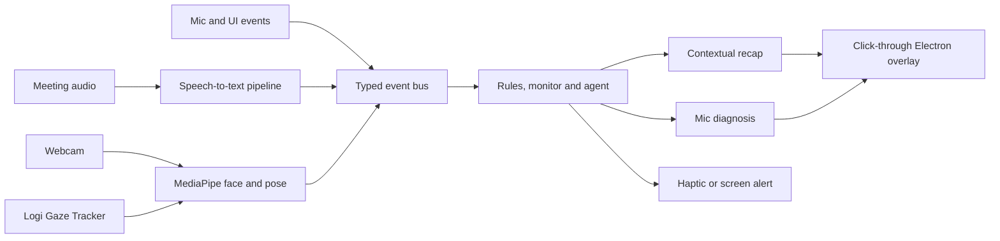

# Tap

### An AI-powered meeting awareness assistant

Tap helps you recover the moments you miss in online meetings. It listens to the meeting, notices when somebody addresses you, and surfaces a concise recap in a focused desktop overlay—without taking control away from you.

> Built for [LauzHack 2026](https://lauzhack.com) in Lausanne, Switzerland.

## The problem

Attention naturally fluctuates during long online meetings. A short distraction can be enough to miss a decision, a question, or the moment somebody says your name. Returning to the conversation is difficult when you do not know what happened or whether the group is waiting for you.

## Our solution

Tap turns meeting audio and webcam signals into timely, understandable cues:

1. It transcribes meeting audio in real time.
2. It detects configured names and common speech-recognition variants.
3. It keeps recent conversation context and tracks when the user looks away.
4. When attention is needed, it presents a contextual recap, the relevant question, and recent transcript in an always-on-top overlay.
5. It detects common microphone problems and offers an explicit, user-triggered fix when one is available.

The overlay remains click-through outside its cards, so Tap stays visible without blocking the meeting application underneath.

## Key features

- **Real-time transcription and captions** — meeting audio is captured through Electron loopback and displayed as readable live captions.
- **Name and question detection** — recognizes the user's name, configured variants, direct questions, and moments when the conversation may be waiting for a response.
- **Contextual recaps** — summarizes the relevant conversation window and retains the recent transcript. Anthropic-powered summaries are optional; a local template fallback works without an API key.
- **Attention awareness** — the Logitech Gaze Tracker follows screen-space gaze to detect true look-aways and returns, with automatic MediaPipe head-pose fallback, allowing recaps to cover the missed interval.
- **Microphone issue detection** — combines microphone levels, mouth movement, Windows microphone state, and phrases such as “we can't hear you” to identify likely audio problems.
- **Desktop overlay notifications** — prioritized, deduplicated notification cards stay above the meeting while preserving click-through interaction elsewhere.
- **Optional haptic cues** — supports a four-signal haptic vocabulary through the configured HapticWeb endpoint, with a screen flash fallback.
- **Check-up and activity views** — exposes camera, microphone, speech-engine, action, and cost status for testing and demonstrations.

## How it works



Tap is split into two Electron windows and a typed main-process pipeline:

- The **main window** starts camera, microphone, and call-audio capture, connects to the local Gaze Tracker when it is available, and provides Check-up, Activity, IT, and development views.
- Renderer sensors emit typed events through the preload bridge defined in [`app/src/shared/events.ts`](app/src/shared/events.ts).
- The **main process** validates and routes events through the event bus, detectors, monitoring rules, and agent executor.
- The **overlay window** renders captions, recaps, warnings, and actions. Meeting transcript text is treated as untrusted data and cannot trigger actions.

For the detailed event flow and developer notes, see [`app/README.md`](app/README.md) and [`docs/PRD.md`](docs/PRD.md).

## Tech stack

| Area | Technology |
|---|---|
| Desktop application | Electron 45, TypeScript 5, HTML and CSS |
| Build tooling | electron-vite 6 and Vite 7 |
| Vision | Logitech Gaze Tracker (default away source) with MediaPipe Tasks Vision for head-pose fallback, mouth, gestures, and camera health |
| Local speech-to-text | sherpa-onnx-node with Parakeet and Silero VAD |
| Cloud speech-to-text | Deepgram streaming API |
| Contextual summaries | Anthropic SDK, with a no-key template fallback |
| Validation and safety | Zod schemas and a typed event contract |
| Testing | Node.js test runner and TypeScript type checking |
| Windows microphone diagnostics | PowerShell and Windows Core Audio interop |

## Installation

### Prerequisites

- Node.js and npm
- Windows 10 or 11 for the current loopback capture and Windows microphone-diagnostic workflow
- `tar` for local speech-model setup (included with current Windows versions)
- A webcam and microphone for live sensor testing

Clone the repository and install the application dependencies:

```bash
git clone https://github.com/Thibaud-Babin/Edgrunners_hackathon.git
cd Edgrunners_hackathon/app
npm install
```

`npm install` also copies the MediaPipe WebAssembly files and downloads the face-landmark model for on-device use.

Create a local environment file:

```powershell
Copy-Item .env.example .env
```

On macOS or Linux, the equivalent command is `cp .env.example .env`. The mock demo does not require API keys. For live use, edit `.env` and configure:

- `TAP_USER_NAMES` for the user's name and likely transcription variants.
- `TAP_STT=deepgram` plus `DEEPGRAM_API_KEY` for cloud transcription, or install the local models below.
- `ANTHROPIC_API_KEY` optionally for generated summaries. Without it, Tap uses a template recap.

For local speech-to-text, download the Parakeet, Silero VAD, and fallback Zipformer models once:

```bash
npm run setup-stt
```

The models require a substantial download. To install only Parakeet and Silero VAD, run:

```bash
node scripts/setup-stt.mjs parakeet
```

## Run and test

Run these commands from `app/`:

| Command | Purpose |
|---|---|
| `npm run dev` | Start Tap in development mode. |
| `npm run dev:call` | Start Tap and automatically begin call-audio capture. |
| `npm run dev:e2e` | Start call capture and trigger the away flow for an end-to-end development check. |
| `npm run mock` | Replay `demo/mock-events.json` without requiring a live meeting, camera, or microphone. |
| `npm run typecheck` | Run strict TypeScript checking without emitting files. |
| `npm test` | Run the agent, detector, bus, monitor, mock, schema, and safety tests. |
| `npm run build` | Create a production build with electron-vite. |
| `npm run start` | Preview the production build. |
| `npm run stt-bench` | Run the configured speech-to-text hotword benchmark. |

The fastest way to evaluate the complete product flow is:

```bash
cd app
npm run mock
```

## Demo

The repository includes a deterministic demo scenario in [`demo/mock-events.json`](demo/mock-events.json). It exercises name mentions, missed-context recaps, waiting-for-response nudges, microphone warnings, dismissals, and transcript safety behavior.

For a live rehearsal checklist, including camera, audio, overlay, and recovery scenarios, see [`docs/team/TEST-rehearsal.md`](docs/team/TEST-rehearsal.md).

> Screenshots and a recorded demo are not currently committed to the repository. This section is ready to link them after the final LauzHack capture.

## Repository structure

```text
app/
├── scripts/                  Model setup, benchmarks, and Windows mic tools
└── src/
    ├── main/                 Electron main process, audio, agents, rules, and haptics
    ├── preload/              Context-isolated renderer bridge
    ├── renderer/             Main window, transparent overlay, vision, audio, and UI
    └── shared/events.ts      Typed event and UI command contract
demo/                         Deterministic mock meeting events
docs/                         Product requirements, research, team notes, and rehearsal guide
```

## Team and acknowledgments

Tap was created for **LauzHack 2026** by contributors verified in the repository history:

- [tibobepfl](https://github.com/tibobepfl)
- [Derdev74](https://github.com/Derdev74)
- [maria1volcano](https://github.com/maria1volcano)
- [Thibaud-Babin](https://github.com/Thibaud-Babin)
- [unusedusername01](https://github.com/unusedusername01)

We acknowledge the open-source projects and services that made the prototype possible, including Electron, MediaPipe, the Logitech Gaze Tracker, sherpa-onnx, Vite, Zod, Anthropic, and Deepgram, as well as the LauzHack organizers and mentors.

---

**Tap** — stay present without losing the moments that matter.
